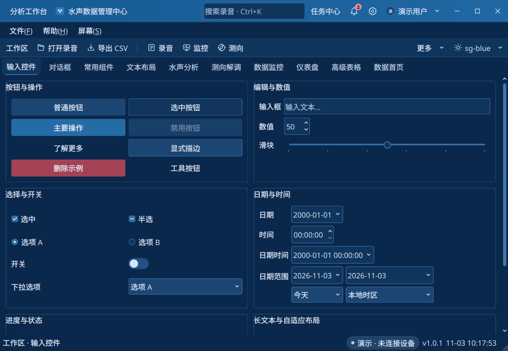

# BaseWidgets

基于 Qt Widgets 的通用 C++ 界面框架与组件库，对外提供输入、布局、窗口、视图、对话框、图形和反馈组件。使用 NativeStyle、QPainter 和 QPalette 绘制，业务图表基于 QCustomPlot；主题、字体和 SVG 随库构建并嵌入，运行时无需 QSS。

## 快速开始

要求 CMake 3.16+、C++14、Qt ≥ 5.11 且 < 6。目标为 Windows 10/11、Ubuntu/KylinOS/UOS，Linux 优先 X11；Wayland 非必需。Linux 需要 Core、Gui、Widgets、PrintSupport、Svg、X11Extras 和 X11。

`widgets_demo` 仅演示组件和接线方式，并承载可选自检。真实采样率、数据内容、存储和业务流程由调用方决定，demo 参数不构成库的全局限制。

```bash
cmake -S . -B build -DCMAKE_BUILD_TYPE=Debug
cmake --build build --target widgets_demo --parallel 4
./build/bin/widgets_demo
```

Windows 多配置生成器加 `--config Debug`，执行文件位于 `build/bin/Debug/`。独立应用使用安装包导出的 `BaseWidgets::BaseWidgets` 目标，详见[构建与接入](docs/guides/installation.md)。

## 文档

- [文档目录](docs/README.md)：所有组件的 API 用法和数据约定。
- [组件库 UI 设计规范](docs/design.md)：公开 API、状态矩阵、布局/主题、键盘、生命周期与交付检查。
- [快速入门](docs/guides/getting-started.md)：初始化、最小程序、线程和所有权。
- [主题与资源](docs/guides/themes-and-resources.md)：配色、SVG 和高 DPI。
- [Demo 导览](docs/guides/demo.md)：页面入口、全局命令与多屏示例。

## 项目结构

| 目录 | 内容 |
|---|---|
| `interface/basewidgets/` / `src/` | 公开接口 / 控件与计算实现 |
| `assets/styles/` | 主题、字体、SVG 源文件及许可证 |
| `cmake/` | 资源构建、安装和包导出 |
| `examples/widgets_demo/` | 控件演示与可选自检 |
| `examples/package_consumer/` | 独立安装包接入示例 |
| `docs/` | 当前设计与使用说明 |

## 界面预览


