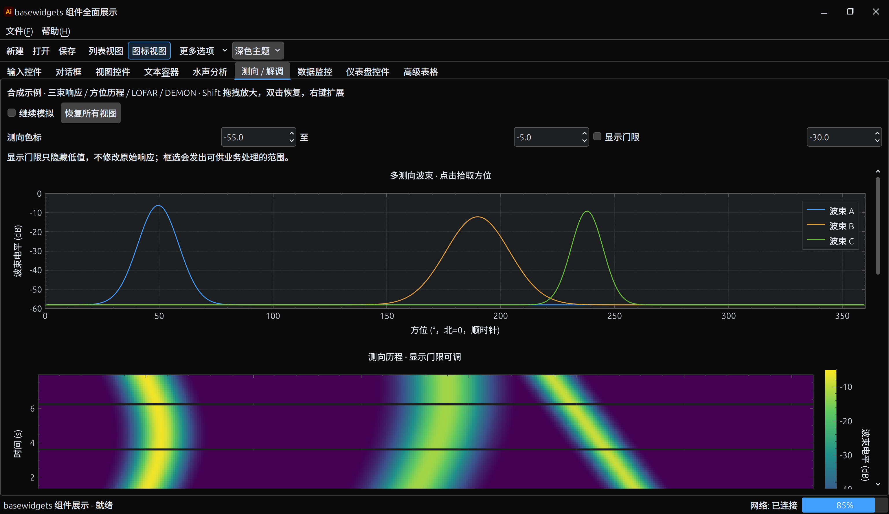
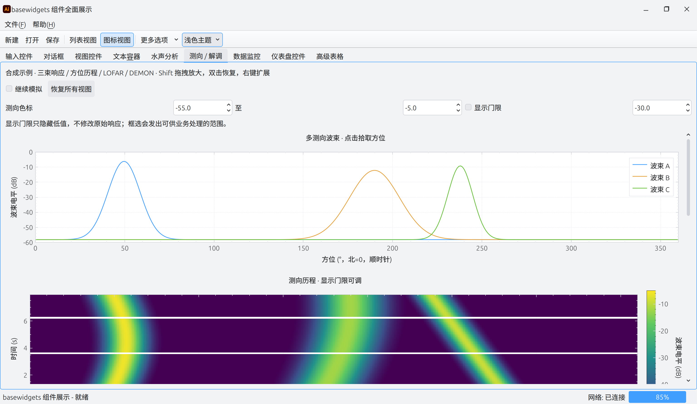

# Qt Advanced UI 示例工程

本仓库包含一套基于 Qt 的高级样式与 UI 组件库，以及一个可运行的示例程序 `widgets_demo`，用于演示控件与布局的实际效果。

#### 暗色主题：


#### 亮色主题：

## 项目简介

- **核心组件库**：位于 `src/` 目录下，集成了样式引擎 (`QtAdvancedStylesheet`) 与各类高级 UI 控件。
- **示例程序**：位于 `examples/widgets_demo/`，全方位展示控件的外观、交互与主题切换效果。
- **主题构建**：编辑 `assets/styles/` 下的 JSON/XML/SVG，构建 UI 库时自动生成并嵌入主题，无需独立 tools 工程。

## 主要特性

- **Inputs**：丰富的输入类控件，包括按钮、文本框、滑块、开关、日期/时间选择器、多选下拉框等。
- **Views**：高级表格统一支持基础/筛选/分页模式、排序时固定源记录、可扩展右键菜单、选择映射和 CSV 导出；另提供树形与列表视图。
- **Charts**：基于 QCustomPlot 的波形/频谱/时频、波束/测向历程、LOFAR/DEMON 与速率监控，支持可扩展菜单、框选放大和双击恢复。
- **Dialogs**：
  - **File Browser**：重构的仿 Ubuntu 风格文件浏览器，支持侧边栏快捷导航、图标/列表多视图切换、面包屑地址栏及暗色模式优化。
  - **Color Picker**：专业级颜色选择器，支持 HSV/RGB/Hex 调节、屏幕取色，并内置库级静态存储以记忆历史颜色。
  - 其他常用对话框（字体选择等）。
- **Multi-screen**：窗口位置按实际屏幕逻辑坐标保存/恢复，支持断屏回退、父屏弹窗和独立监控窗口。
- **Containers**：分组框、工具栏、状态栏、侧边栏容器等布局组件。
- **Gauges**：原生 QPainter 仪表：`CircularGauge`（弧形/指针）、`CompassGauge`（航向）、`AttitudeMeter`（姿态），支持明暗主题、阈值、目标与无数据状态；另有容量、双向速率、任务队列、数据核验质量仪表。
- **Styles**：运行时使用 `NativeStyle`（QProxyStyle + QPainter）和主题调色板替代 QSS，支持明暗切换、SVG 图标着色与 DPI 适配；资源随库自动生成和嵌入，旧 QSS 解析和导出已删除。

## 目录结构

```
QtAdvancedUI/
├── CMakeLists.txt              # 根构建文件（骨架，双发布流程分支）
├── src/                        # 核心库实现
│   └── CMakeLists.txt          # BaseWidgets 目标定义
│       ├── ... (对应头文件目录)
├── interface/basewidgets/      # 公共头文件
│   ├── Charts/
│   ├── Containers/
│   ├── Core/
│   ├── Dialogs/
│   ├── Gauges/
│   ├── Inputs/
│   ├── Styles/                 # 样式引擎接口
│   └── Views/
├── assets/styles/              # 可编辑主题源文件 (JSON/XML/字体/SVG)
├── examples/
│   └── widgets_demo/           # 演示程序源码
└── cmake/resources/            # 主构建内部资源生成器（不依赖 UI 库）
```

## 构建环境

- **操作系统**：Windows 10/11（推荐 MSVC 2019/2022）
- **依赖**：CMake ≥ 3.20；Windows 使用 Qt 5.15.x 或 Qt 6.x。Linux 当前使用 Qt 5.15.x（窗口实现依赖 `QX11Info` / `X11Extras`），需安装 Core、Gui、Widgets、PrintSupport、Svg、X11Extras 和 X11 开发包。
- **配置**：若 CMake 无法自动找到 Qt，请设置 `CMAKE_PREFIX_PATH` 环境变量指向 Qt 安装目录。
  - 例如：`C:\Qt\6.5.3\msvc2019_64`

## 快速构建与运行

在工程根目录执行以下命令：

```powershell
# 1. 配置项目
cmake -S . -B build -DCMAKE_BUILD_TYPE=Release

# 2. 编译示例程序
cmake --build build --config Release --target widgets_demo -j 8
```

若需调试版本，将 `Release` 替换为 `Debug` 即可。

## 打包与安装

- 项目默认打包链使用纯 `CMake/CPack`，不依赖 Node.js。
- 仓库同时保留 `cmake/package/` 下的 JS/模板文件，供外部 Node 打包工具复用；它们不是默认 CMake 构建的硬依赖。
- 生成安装树：

```bash
cmake --build build --target package_dir -j 8
```

- 按组件生成安装树：

```bash
cmake --build build --target package_runtime_dir -j 8
cmake --build build --target package_development_dir -j 8
cmake --build build --target package_assets_dir -j 8
```

- 也可以直接使用原生组件安装命令：

```bash
cmake --install build --prefix build/package/install-runtime --component Runtime
cmake --install build --prefix build/package/install-development --component Development
cmake --install build --prefix build/package/install-assets --component Assets
```

- 生成压缩包（ZIP/TGZ）：

```bash
cmake --build build --target package -j 8
```

- 默认输出目录：
  - 安装树：`build/package/install/`
  - 压缩包：`build/package/`
- 安装树中会导出标准 CMake 包配置，供其他项目通过 `find_package(BaseWidgets CONFIG REQUIRED)` 直接引用。
- 安装组件约定：
  - `Runtime`：库文件与运行时二进制
  - `Development`：头文件、CMake 配置、导出 targets、README
  - `Assets`：`themes.rcc` 等主题资源
- 可通过以下缓存变量自定义压缩包文件名：
  - `BASEWIDGETS_PACKAGE_FILE_BASENAME`
  - `BASEWIDGETS_PACKAGE_FILE_VERSION`
  - `BASEWIDGETS_PACKAGE_PLATFORM_NAME`
  - `BASEWIDGETS_CPACK_GENERATORS`
- 如需启用历史遗留的 plugin release 流程，可在配置时显式传入：

```bash
cmake -S . -B build -DUI_ENABLE_PLUGIN_RELEASE=ON
```

### 作为 CMake 包使用

```cmake
find_package(BaseWidgets CONFIG REQUIRED)
target_link_libraries(YourApp PRIVATE BaseWidgets::BaseWidgets)
```

- 如果使用本地安装树，可在配置时追加：

```bash
cmake -S . -B build-app -DCMAKE_PREFIX_PATH=/path/to/basewidgets/build/package/install
```

- 仓库提供了一个独立的外部消费示例：
  - [package_consumer](file:///home/harry/Git/basewidgets/examples/package_consumer)

```bash
cmake -S examples/package_consumer -B build/package_consumer \
  -DCMAKE_PREFIX_PATH=/path/to/basewidgets/build/package/install
cmake --build build/package_consumer -j 8
```

## 开发指南

### 仪表盘 (Gauges)
仪表盘控件已模块化，位于 `interface/basewidgets/Gauges/`。
- **CircularGauge**：通用弧形/指针仪表，突出数值，分离阈值带与当前值轨道，支持目标值和无数据状态。
- **使用示例**：
  ```cpp
  auto gauge = new CircularGauge(parent);
  gauge->setRange(0, 100);
  gauge->setValue(75);
  gauge->useCompletionRatePreset("完成率", "%");
  ```

### 主题与样式

- 主题源文件位于 `assets/styles/themes/`；修改后重新构建 `BaseWidgets` 即可。
- 内部依赖链为：资源生成器 → JSON/XML/SVG/字体生成 → C++ 资源 → UI 库，没有循环依赖。
- `StyleManagerAdapter::initialize()` 默认使用库内嵌的 `:/styles`，不受工作目录或旧 `themes.rcc` 影响。
- 需要显式覆盖时，第一个参数可传 styles 目录或外部 RCC 路径。
- 独立 RCC 生成到 `<build>/generated/assets/themes.rcc`，CPack 安装到 `assets/`；它不是默认运行所必需的文件。
- 构建产物留在构建目录，不再提交二进制主题包。交叉编译时需提供 `BASEWIDGETS_HOST_RESOURCE_BUILDER` 宿主工具。
- 按钮使用 `setAppearance(ButtonAppearance::Primary/Subtle/Outline/Danger)` 表达层级；普通按钮默认无描边。
- 接入代码、所有权约定和各页面入口见 [widgets_demo 说明](examples/widgets_demo/README.md)。

## 硬规则（长期架构约束）

- 样式单源：运行时由 `NativeStyle`（QProxyStyle + QPainter）与 `ThemeTokens` 统一驱动；保留 Qt 控件交互，禁止在控件或应用中拼接/注入 QSS。复杂原生绘制使用统一 QPalette。
- 控件分层：基础控件（Inputs/Views/Containers）不得依赖业务模块；复合控件（Dialogs/页面容器）只做组合与编排；平台适配仅允许出现在 Core（或独立 Platform 模块）中，禁止散落到各控件实现里。
- Token 化：主题变量（themes.json / *.xml）作为设计 token 的唯一来源；自绘场景通过样式管理器提供的 token 查询能力拿值，禁止把颜色/圆角/间距等视觉常量散落在代码中。
- 动态属性契约：新增样式状态属性使用 `bw*` 前缀，由 NativeStyle 显式处理；兼容已有 `primary/active` 状态。新增属性应同时实现绘制与重绘通知，不能只声明旧 QSS 选择器。

## 变更记录（近期）

- **架构调整**：主题源归入 `assets/styles`，资源生成整合进主 CMake 构建，并直接嵌入 UI 库。
- **File Browser**：全新仿 Ubuntu 风格文件浏览器，集成侧边栏与多视图支持。
- **Color Picker**：优化颜色记忆机制，实现跨会话的库级状态持久化。
- **Gauges**：新增多种仪表盘控件，统一视觉风格（阴影、高光、动态线宽）。

### 仪表盘迁移

重复的 `BasicGauge`、`SpeedGauge` 与旧 `QcGaugeWidget` 引擎已移除。
速度/压力类场景统一使用 `CircularGauge::DisplayMode::Needle`；详情与移除接口见
[仪表盘重构与迁移](docs/gauges-native-redesign.md)。示例集中在 `widgets_demo/pages/GaugesPage.cpp`。

### 水声处理与数据管理

新增 `AcousticWaveformPlot`、`AcousticSpectrumPlot`、`AcousticSpectrogramPlot`、`RecordingTimelinePlot`，
以及 `SignalQualityMeter`、`AcquisitionStatusPanel`。图表继续基于 QCustomPlot；DSP 辅助计算与 GUI 分开。
详见 [单位、算法约定与迁移说明](docs/underwater-acoustics-controls.md)，demo 位于 `widgets_demo/pages/AcousticPage.cpp`。
旧 QCPLineChart/QCPBarChart/QCPWaterfallChart 薄封装已删除，通用图形仍可直接使用 StyledPlot + QCPGraph/QCPBars。

### 测向、解调与监控扩展

新增多波束 `BeamPatternPlot`、测向历程 `BearingHistoryPlot`、`LofarPlot`、`DemonSpectrumPlot/DemonHistoryPlot`，
以及容量 `StorageCapacityMeter`、双向网速 `TransferRateMeter`、指标历程 `RateHistoryPlot`。
所有 StyledPlot 图表统一支持右键扩展、双击/Home 恢复、Shift 框选缩放、选区和坐标信号。
详见 [交互、DEMON 算法边界与监控 API](docs/advanced-acoustic-and-monitoring-controls.md)。

高级表格固定行、多屏窗口和新增数据管理仪表的接入约定见 [接口与示例说明](docs/tables-multiscreen-and-data-dashboards.md)。
