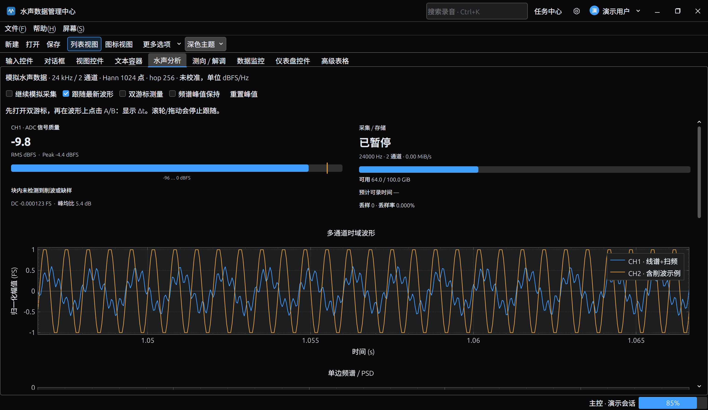
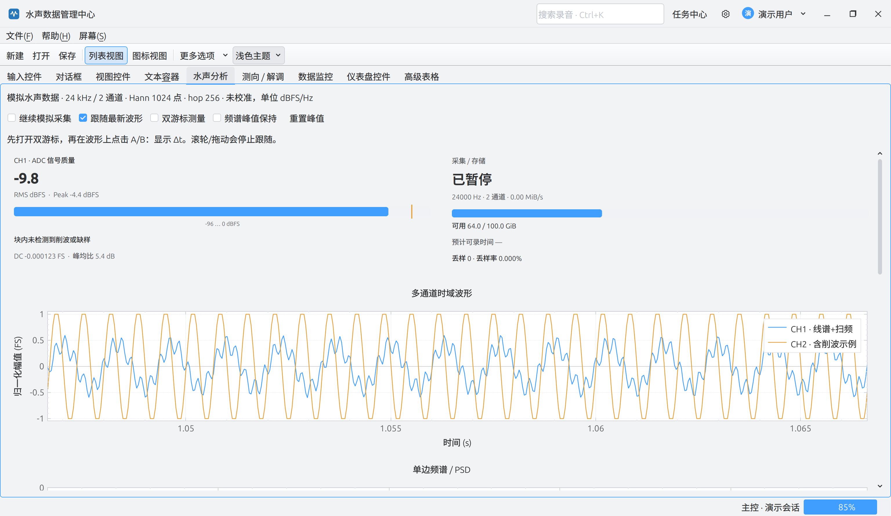

# BaseWidgets

基于 Qt Widgets 的 C++ UI 组件库，面向水声数据处理与数据管理应用。运行时通过 NativeStyle、QPainter 和 QPalette 绘制，不生成或应用 QSS；业务图表基于 QCustomPlot。

## 快速开始

在仓库根目录执行：

```bash
cmake -S . -B build -DCMAKE_BUILD_TYPE=Debug
cmake --build build --target widgets_demo --parallel 4
./build/bin/widgets_demo
```

要求 CMake 3.16+、C++14。Linux 当前构建选择 Qt 5.15，并依赖 Svg、PrintSupport、X11Extras 和 X11；非 Linux 构建可选择 Qt5/Qt6。Windows 多配置生成器使用 `--config Debug`，可执行文件位于 `build/bin/Debug/`。具体依赖和安装接入见[快速入门](docs/guides/getting-started.md)。

## 文档

完整目录与阅读路线：[文档首页](docs/README.md)。

| 主题 | 入口 |
|---|---|
| 初始化、线程、所有权 | [快速入门](docs/guides/getting-started.md) |
| 主题、SVG、字体、DPI | [主题与资源](docs/guides/themes-and-resources.md) |
| 九个演示页和多屏预览 | [Demo 导览](docs/guides/demo.md) |
| 输入、布局、对话框 | [基础控件](docs/components/basic-widgets.md) |
| 排序、固定记录、跨页勾选、CSV | [高级表格](docs/components/advanced-table.md) |
| 右键扩展、框选、复位、联动 | [图表交互](docs/components/chart-interaction.md) |
| 波形、PSD、时频与录音时间线 | [水声分析](docs/components/acoustic-analysis.md) |
| 多波束、测向历程、LOFAR/DEMON | [测向与解调](docs/components/direction-and-demon.md) |
| 容量、网速、任务、数据质量 | [数据管理仪表](docs/components/monitoring.md) |
| 数值、航向、姿态 | [通用仪表](docs/components/gauges.md) |
| 标题、搜索、用户入口 | [标题栏](docs/components/title-bar.md) |
| 主控与多个独立子屏 | [多屏工作区](docs/components/multi-screen.md) |
| CMake、安装、外部引用、CPack | [构建与发布](docs/development/cmake-and-packaging.md) |
| 验证命令与实机边界 | [验证指南](docs/development/validation.md) |
| 架构约束与旧 API 替代 | [架构](docs/development/architecture.md) · [迁移](docs/development/migration.md) |

## 目录

```text
interface/basewidgets/  公开接口
src/                    UI 库与计算工具实现
assets/styles/          主题、字体和 SVG 源文件
cmake/resources/        内部资源生成器
cmake/package/          安装、导出与发布配置
examples/widgets_demo/  所有控件演示及可选检查
examples/package_consumer/  独立安装包引用示例
docs/                   分类文档与截图
```

主题在构建库时自动生成并嵌入；默认运行不需要复制 assets 或执行独立资源工具。

## 主题预览

暗色：



亮色：


