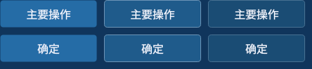
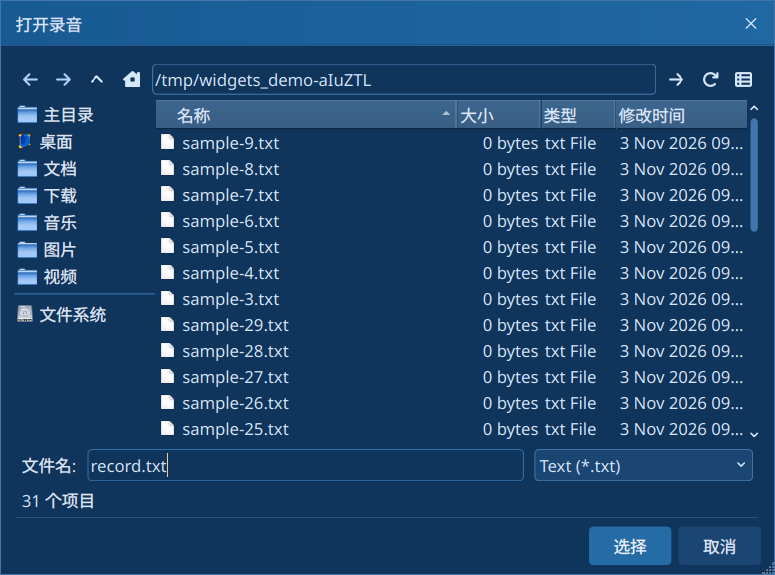

# 基础控件、布局与对话框

[文档首页](../README.md)

公开接口位于 `interface/basewidgets/Inputs`、`Containers`、`Views`、`Dialogs`。基础包装保留 Qt 控件的信号、编辑、键盘和模型/委托接口；绘制交给应用级 NativeStyle。

## 按钮与选择状态

```cpp
#include <basewidgets/Inputs/PushButton.h>
using namespace basewidgets;

auto* save = new PushButton("保存", parent);
save->setAppearance(ButtonAppearance::Primary);
auto* cancel = new PushButton("取消", parent); // 默认 Neutral，无常驻描边
auto* help = new PushButton("说明", parent);
help->setAppearance(ButtonAppearance::Subtle);
auto* toggle = new PushButton("固定面板", parent);
toggle->setCheckable(true);
```

每个操作区通常选择一个主要动作。Primary 为实色强调，Subtle 用于轻操作，Outline 显式常驻描边，Danger 表示危险操作；Danger 本身不执行确认或删除。checked 与视觉优先级分别表达，键盘焦点保留。主要/危险按钮和弹窗确定按钮在悬停时改变底色并显示轻边框，按下进一步加深，移出恢复；禁用时不产生悬停反馈。

下图依次为默认、悬停、按下；上行为主要按钮，下行为弹窗确定。



CheckBox 支持三态；RadioButton 保留 Qt 排他逻辑。ToggleSwitch 使用 toggled 驱动动画，键盘和程序设置均生效。BusyIndicator 隐藏时停止内部动画计时，显式颜色不会被主题切换覆盖。

ToolButton 保留 InstantPopup、DelayedPopup 和 MenuButtonPopup；文字按钮预留菜单箭头，分离按钮共用绘制/命中几何。标题栏的紧凑纯图标菜单入口有专门绘制，见[标题栏](title-bar.md)。

## 日期范围与输入

DateRangePicker 默认“今天”，可选择时间和时区。`setRange` 无效输入保持原值，反序规范为 start≤end，批量更新只发一次 rangeChanged。改变时区按显示的当地墙钟时间解释；`includeTime=false` 返回午夜时间，不代表自动覆盖一整天的结束边界。

LineEdit、TextEdit、PlainTextEdit、ComboBox、SpinBox 等沿用 Qt 输入/编辑行为；不要再为局部控件注入 QSS。

## 视图与布局

- TableView/ListView/TreeView 保留 Qt model/view 接口；需要表格筛选、分页和勾选时使用 [AdvancedTable](advanced-table.md)。树形聚合使用 TreeTable。
- NavigationList 的事件提供业务 ID、标题和当前行号；业务 ID 与行号分别使用，重复显式 ID/空标题被忽略。
- ResponsiveGridLayout 根据逻辑宽度减少列数，支持 height-for-width、隐藏项和 RTL。极窄窗口可外包 ScrollArea，避免业务最小尺寸强撑主窗口。
- ElidedLabel 在绘制时省略长文本，text() 保留全文；tooltip 由调用方配置。
- TabWidget 的标签和页面内容框默认都不画鼠标 hover 强调。`setHoverEffectEnabled(true)` 只启用标签；`setContentHoverEffectEnabled(true)` 单独启用页面外框。选中和键盘焦点保持，内容里的输入框仍有正常反馈。
- GroupBox、Frame 等容器边框默认静态；需要鼠标强调时显式设置 `bwFrameHoverEnabled=true`，不把容器视为输入控件。

## 常用交互与反馈

SegmentedControl、FilterChip、MessageBanner、EmptyState 的接口、键盘操作与业务信号见[常用组件](common-widgets.md)。这些控件在主 demo 的“常用组件”页面展示，配色随主题更新。

## 标准对话框入口

公共高层入口是 `Dialogs/DialogUtils.h`。文件选择器实现位于 src 内部；不要使用不存在的公开 FilePickerWidget/ColorPickerWidget 示例。

```cpp
#include <basewidgets/Dialogs/DialogUtils.h>

const QString file = basewidgets::DialogUtils::openFile(
    parent, "选择录音", QString(), "Wave (*.wav);;All files (*)");
if (!file.isEmpty()) {
    // 用文件路径加载业务数据。
}

const QColor color = basewidgets::DialogUtils::pickColor(parent);
// 取消会返回有效初始色或最近选择色；此接口不单独返回 accepted 状态。
// 用返回值更新颜色预览；需要区分取消时使用自建 FramelessDialog。

bool accepted = false;
const QFont font = basewidgets::DialogUtils::pickFont(parent, QFont(), &accepted);
```

取消约定：文件/目录/文本返回空值，多文件返回空列表；pickColor 取消时返回有效初始色或最近选择色；pickFont 通过 bool* 区分。inputInt/inputDouble 取消时返回输入默认值，因此无法仅用返回值区分“取消”和“确认默认值”；颜色/文本/数值输入若需要明确接受状态，应使用自建 FramelessDialog。

最近颜色与颜色历史保留在进程内静态状态，不自动持久化到下一次启动。需要跨启动保存时由应用负责。

文件选择会验证路径、遵循调用方的文件类型过滤器；保存已存在的文件时要求确认覆盖，选择文件夹时可直接确认当前目录。窗口按屏幕空间调整尺寸，窄屏隐藏侧栏和次要列，优先保留文件列表。路径选择只返回结果，不执行文件解析或保存。



## 自建弹窗

FramelessDialog 提供内容区、简洁标题和可选按钮页脚。标准确认/取消默认纯文字；按钮排列、焦点和模态规则保留 Qt 行为。表面采用浮层底色、外边框和页脚分隔线。

```cpp
#include <basewidgets/Core/FramelessDialog.h>
#include <basewidgets/Inputs/Label.h>

auto* dialog = new basewidgets::FramelessDialog(parent);
dialog->setAttribute(Qt::WA_DeleteOnClose);
dialog->setTitle("录音详情");
dialog->setContentWidget(new basewidgets::Label("这里放业务详情"));
QObject::connect(dialog, &basewidgets::FramelessDialog::okButtonClicked,
                 dialog, &QDialog::accept);
QObject::connect(dialog, &basewidgets::FramelessDialog::cancelButtonClicked,
                 dialog, &QDialog::reject);
dialog->open();
```

OK/Cancel 信号允许应用先校验再 accept/reject；内容替换由容器负责隐藏并延迟删除旧内容。标题对齐/图标见[标题栏](title-bar.md)，父屏定位见[多屏工作区](multi-screen.md#普通窗口的位置保存与恢复)。

## 示例

对应 `examples/widgets_demo/pages/InputsPage.cpp`、`CommonWidgetsPage.cpp`、`TextPage.cpp`、`DialogsPage.cpp`。
